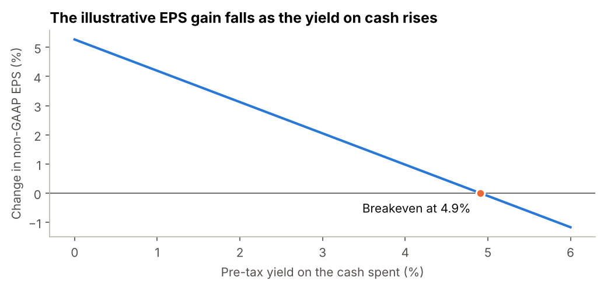

# M&A Deal Analyzer: Microsoft / Activision Blizzard

**Author:** Manuel Ferreira

A retrospective Python analysis of Microsoft's $95-per-share, all-cash acquisition of Activision Blizzard, announced in January 2022 and completed in October 2023.

**Question:** Was the price defensible against simple market benchmarks, and how did the market and Microsoft's EPS respond?



## Results

| Measure | Result |
|---|---|
| Premium to the prior close ($65.39) | 45.3% |
| Premium to the 30-day volume-weighted price | 50.3% |
| Enterprise value at $95 (announced) | $68.7bn |
| Estimated diluted shares implied by the headline | 794.9m |
| Bottom-up diluted shares, RSUs at target and options at average strike | 795.9m |
| EV / Revenue | 7.8x (peers 4.4x to 5.3x) |
| P/E | 28.0x (peers 42.6x to 48.0x) |
| EV / Adjusted EBITDA, main definition | 20.4x (peers 22.8x to 25.5x) |
| EV / Adjusted EBITDA, adding capitalized software | 18.6x (peers 18.5x to 22.8x) |
| Microsoft abnormal return on announcement day | -0.37% (t = -0.42, not significant) |
| Activision market-adjusted return on announcement day | +27.7% |
| Implied probability in a simplified binary model | About 57%, conditional on a $65.39 fallback |
| Illustrative non-GAAP EPS change, no synergies, 1% yield on cash | +4.2% |
| Yield on cash at which that change falls to zero | 4.9% |
| Illustrative GAAP EPS change with $2.5bn of incremental amortization | -0.2% |

The EPS figures are a simplified sensitivity. They are not an accounting pro forma, and they do not show that the deal created value or that its price was fair.

## My conclusions

**1. Price.** I think $95 was defensible, but I can't say it was cheap or that the deal created value. The 45.3% premium cost about $23.5bn on my share estimate, and 7.8x revenue is well above EA and Take-Two. Earnings give a different picture: the P/E of 28.0x is below both. Activision's 37% operating margin is more than double theirs, which helps explain why sales and earnings multiples point in different directions, although I can't show it is the cause. I don't rely much on EV/Adjusted EBITDA, because the comparison changes depending on how capitalized software is treated. With only two peers and dates that don't fully match, the most I would say is that the price doesn't look obviously excessive. The EPS result below doesn't change this. Whether the deal created value depends on cash flows, cost of capital and strategic benefits that I didn't model.

**2. Market reaction.** Microsoft's share price told me very little. The abnormal return on the day was small and not significant with any of the three benchmarks. That isn't surprising: the deal was about 3% of Microsoft's market value and large technology stocks were falling that day, so I can't isolate the effect of the deal. Activision is more informative, since it closed well below $95. My simple model turns that gap into about 57%, but I treat this as a sign that investors were cautious, not as the real chance of completion. It depends on the fallback price, and the gap also pays investors for waiting until closing. The deal needed regulatory review, which was probably part of that caution.

**3. EPS.** At a 1% yield on cash, non-GAAP EPS rises by 4.2% in my model, which fits Microsoft's statement that the deal would be accretive. With $2.5bn of extra amortization, GAAP EPS is about flat. The number I find most interesting is the 4.9% breakeven yield. The Fed's target range went from 0% to 0.25% in January 2022 to 5.25% to 5.50% by September 2023, so the wait for closing may have made the cash more expensive to give up. This is still a hypothesis, because I didn't measure what Microsoft earned on its cash or what Activision earned in 2023.

**4. Next steps.** I would add more peers and past deals, match prices and financials by date, use forecasts for the closing year and get full daily Activision prices from a licensed database. To test value creation properly, I would need a cash flow model with its own assumptions for cost of capital and synergies.

## What the analysis covers

1. **Price paid:** premiums, an estimated diluted share count and independent checks on it
2. **Valuation:** multiples against Electronic Arts and Take-Two, with an explicit EBIT to Adjusted EBITDA reconciliation
3. **Market reaction:** a market-model event study for Microsoft with three benchmarks, and a deal-spread reading for Activision
4. **Illustrative EPS impact:** non-GAAP and GAAP cases
5. **Sensitivities:** offer price against yield, and synergies against amortization
6. **Later comparison:** the model against what Microsoft later reported, as context rather than validation

## Dates and data

This is a retrospective analysis, not a reconstruction of what was known on 18 January 2022.

| Data | Date or period | Published |
|---|---|---|
| Activision, Microsoft and index prices | Around 18 January 2022 | Market data |
| Peer share prices | EA: 12 Jan 2022; Take-Two: 14 Jan 2022 | Market data |
| Activision financials | Year to December 2021 | February 2022, after the announcement |
| Microsoft financials | Year to June 2021 | July 2021, before the announcement |
| Peer financials | Years to March 2022 | May 2022, after the announcement |
| Deal outcome and Microsoft's later results | October 2023 onwards | Later comparison only |

Each input in `data/inputs.csv` has its period, publication date, source and URL. `data/README.md` explains where the price series came from and how they were prepared.

## Run it

Tested with Python 3.13.18. The exact library versions are in `requirements.txt`.

The notebook already shows its results and needs no setup to read. Its market sections need daily prices, which are not in this repository. To re-run everything, supply your own data as `data/README.md` explains:

```bash
pip install -r requirements.txt
python tools/import_prices.py path/to/your_prices.csv
python tools/execute_notebook.py
python tests/test_deal_model.py
python tests/test_tools.py
python tests/test_project.py
```

Without market data, `python tools/execute_notebook.py --partial` runs the price, valuation and EPS sections. It saves to `partial_run/`, marks the run as partial and leaves the saved analysis unchanged. `tools/execute_notebook.py` runs Python code cells only and is not a full replacement for Jupyter. To open the notebook interactively, run `pip install notebook` and then `jupyter notebook analysis.ipynb`.

A GitHub Actions workflow is configured to run the three test files. It runs without market data, so `tests/test_project.py` reports the checks that need it as skipped.

## Repository structure

```text
analysis.ipynb              Full analysis with outputs
src/deal_model.py           Reusable calculations with input validation
src/price_data.py           Schema and validation for daily prices
tests/test_deal_model.py    Checks on the calculations
tests/test_tools.py         Synthetic checks on data validation and the tools
tests/test_project.py       Checks that inputs, notebook, README and charts agree
tools/import_prices.py      Validates and imports your own daily price data
tools/execute_notebook.py   Runs the notebook and regenerates the charts
data/inputs.csv             Financial inputs, each with its source
data/README.md              Data origin and preparation
LICENSE                     MIT License for the code
charts/                     Exported charts
```

## Limitations

- **Small peer set and mismatched dates:** two peers give a sense-check rather than a valuation. Peer years end after the announcement, and their prices are from January 2022.
- **Adjusted EBITDA:** this is a project definition. Game companies capitalize different amounts of development spending, and reported items are not fully comparable, so EV/Adjusted EBITDA gets little weight.
- **Share counts:** the 794.9m and 795.9m are estimates. The second uses RSUs at target and the average option exercise price. Peer multiples use weighted average diluted shares rather than counts at the pricing date. I could not find a complete public bridge between awards, consideration and net cash at one date.
- **EPS model:** it combines different fiscal years, uses one tax rate for all items, and leaves out integration and transaction costs and most purchase accounting. The 1% yield, the $2.5bn of incremental amortization and the synergy ranges are my own assumptions. At a 0% yield the price has no effect on EPS, which shows the limits of EPS as a measure.
- **Event study:** an abnormal return is not a causal estimate. The announcement day coincided with a broad fall in large technology stocks. Standard errors assume independent, normally distributed residuals with constant variance, and Microsoft is a large part of the benchmarks used.
- **Activision price data:** data providers no longer serve the delisted ticker, so only key closes are used. Its reaction is market-adjusted rather than estimated with a full market model.
- **Implied probability:** this comes from a simplified binary model with no discounting or risk premium, conditional on the fallback price. It is not an objective probability of completion.
- **Market data:** the saved event-study results were computed from Yahoo Finance series that are not distributed here, and the repository has no automatic download. The tools and tests have not been run with data from another provider.
- **Secondary sources:** the $65.39 close, the $82.31 close, the EA price, the S&P 500 close at completion and the earnings call transcript come from secondary sources. The $65.39 is consistent with the 45.3% premium in the merger proxy.

## Sources

- [Microsoft announcement, 18 January 2022 (Form 8-K exhibit)](https://www.sec.gov/Archives/edgar/data/789019/000119312522010667/d301984dex991.htm)
- [Activision 2021 Form 10-K](https://www.sec.gov/Archives/edgar/data/718877/000162828022003992/atvi-20211231.htm)
- [Activision Q4 and FY2021 results](https://www.businesswire.com/news/home/20220202006035/en/Activision-Blizzard-Announces-Fourth-Quarter-and-2021-Financial-Results)
- [Activision merger proxy (DEFM14A)](https://www.sec.gov/Archives/edgar/data/718877/000110465922036155/tm225196-4_defm14a.htm)
- [Merger agreement summary: termination fees](https://www.marketscreener.com/quote/stock/ACTIVISION-BLIZZARD-INC-3780631/news/ACTIVISION-BLIZZARD-INC-Entry-into-a-Material-Definitive-Agreement-Amendments-to-Articles-of-In-37584377/)
- [Microsoft Q4 FY2021 results (Form 8-K exhibit)](https://www.sec.gov/Archives/edgar/data/789019/000119312521225746/d200100dex991.htm)
- [Microsoft Q4 FY2021 press release: non-GAAP results](https://news.microsoft.com/2021/07/27/microsoft-cloud-strength-fuels-fourth-quarter-results-2/)
- [Microsoft 10-Q for March 2024: Activision purchase price allocation](https://www.sec.gov/Archives/edgar/data/789019/000095017024048288/R33.htm)
- [Microsoft Q2 FY2024 earnings call transcript (MarketBeat)](https://www.marketbeat.com/earnings/transcripts/101360)
- [Microsoft earnings date, January 2022](https://news.microsoft.com/2022/01/11/microsoft-announces-quarterly-earnings-release-date-50)
- [Electronic Arts FY2022 Form 10-K](https://www.sec.gov/Archives/edgar/data/712515/000071251522000011/ea-20220331.htm)
- [Take-Two Q4 FY2022 results (Form 8-K exhibit)](https://www.sec.gov/Archives/edgar/data/946581/000162828022014496/ttwo4q22earningsrelease.htm)
- [Take-Two FY2022 results: balance sheet](https://www.businesswire.com/news/home/20220516005693/en/Take-Two-Interactive-Software-Inc.-Reports-Strong-Results-for-Fiscal-Year-2022/)
- [Federal Reserve statement, September 2023](https://www.federalreserve.gov/newsevents/press/monetary/20230920a.htm)
- [Federal Reserve statements, 2022](https://www.frbdiscountwindow.org/archive?year=2022)
- [Market commentary, 18 January 2022 (Malay Mail / Reuters)](https://www.malaymail.com/news/money/2022/01/18/wall-street-falls-on-tech-drag-gs-results-trigger-more-bank-declines/2036006)
- [Activision $65.39 price (Kiplinger)](https://www.kiplinger.com/investing/stocks/tech-stocks/604073/activision-blizzard-microsoft-deal)
- [Activision January 2022 and December 2021 closes (MarketScreener)](https://ca.marketscreener.com/quote/stock/ACTIVISION-BLIZZARD-INC-3780631/news/Activision-Blizzard-on-Pace-for-Largest-Percent-Decrease-Since-November-2021-Data-Talk-42411764/)
- [Activision 2023 closes (Stock Analysis)](https://stockanalysis.com/stocks/atvi/history)
- [EA close before 13 January 2022 (Zacks article)](https://business.minstercommunitypost.com/minstercommunitypost/news/read/42108292/electronic_arts_)
- [S&P 500 close, 13 October 2023 (Malay Mail / Reuters)](https://www.malaymail.com/news/money/2023/10/14/sp-500-nasdaq-fall-with-data-geopolitics-offsets-strong-results/96171)
- Microsoft and index series, and the Take-Two price: Yahoo Finance

## License and data

- **Code:** the Python files and notebook code cells are under the [MIT License](LICENSE).
- **Text and original charts:** © Manuel Ferreira. All rights reserved, unless stated otherwise.
- **Third-party data and content:** not covered by the MIT License, and subject to each provider's terms. See `data/README.md`.

For educational purposes only; not investment advice.
